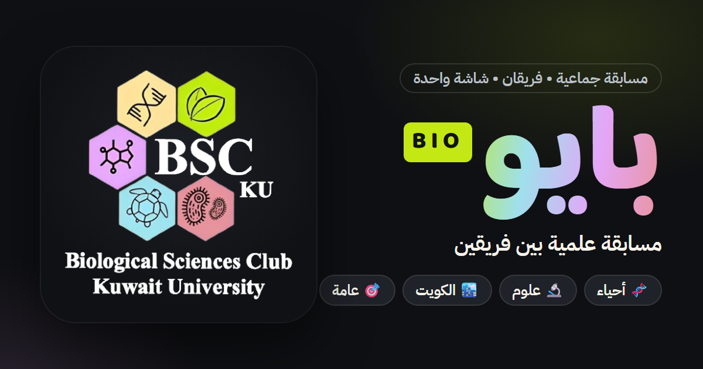

# 🧬 بايو (BIO) — مسابقة علمية بين فريقين

لعبة مسابقات جماعية لفريقين ومقدّم واحد على شاشة واحدة، فيها أسئلة في الأحياء والعلوم والمعلومات العامة وعن الكويت. موقع ثابت (HTML/CSS/JS) بلا أدوات بناء، ويمكن تثبيته كتطبيق (PWA).

**العب الآن:** https://ahmed921x-art.github.io/jam3a-game/



## المميزات
- **50 فئة و482 سؤالاً**: أربع فئات أحياء جديدة (الخلية، الوراثة، الأحياء الدقيقة، البيئة والتطور) بجانب العلوم والكويت والفئات العامة. الأسئلة تختلف في كل لعبة.
- **بحث وتصفية للفئات**: أحياء وعلوم / الكويت / عامة / فئاتي / المختارة.
- **وسائل مساعدة** لكل فريق: 🔄 تبديل السؤال · 📞 اتصال بصديق (دقيقة يتوقف فيها المؤقت) · ✌️ جوابان.
- **👑 الجولة الذهبية** (اختيارية) برهان سريع، و**⚡ شوط فاصل** عند التعادل.
- **تصحيح النقاط يدوياً** للمقدّم من لوحة اللعب.
- **محرر فئات** خاص بكل مستخدم + تصدير واستيراد JSON.
- **حسابات Google** (Firebase) أو اللعب كضيف، مع إحصائيات وإنجازات وسجل مباريات.
- **العربية RTL والإنجليزية LTR**، والوضع الداكن والفاتح، وخمسة ألوان مأخوذة من خلايا الشعار.
- **مصمّمة للجوال أولاً**: أهداف لمس 44–56px، ودعم لوحة المفاتيح والتركيز، وتحترم «تقليل الحركة».

## التشغيل
```bash
python -m http.server 8765
# ثم افتح http://localhost:8765
```
الخادم مطلوب للـ Service Worker، وكل الباقي يعمل بفتح `index.html` مباشرة.

## اختصارات أثناء السؤال
| المفتاح | الوظيفة |
|---|---|
| `Space` | عرض الإجابة |
| `1` / `2` | النقاط للفريق الأول / الثاني (بعد عرض الإجابة) |
| `0` | ولا أحد |
| `Esc` | إغلاق النافذة أو الرجوع للوحة |

## الهوية البصرية
- **الشعار:** `assets/logo.png` (الأصل كما هو). `logo-full.png` قصّ على حدوده، و`logo-mark.png` الخلايا مع BSC KU بدون سطر الاسم الطويل، للأماكن الصغيرة والأيقونات. نص الشعار أبيض، لذلك يُعرض دائماً على لوح داكن.
- **الألوان** (من خلايا الشعار): كريمي `#f9e09b` · ليموني `#c3e813` · أوركيدي `#e4a6f7` · سماوي `#9fe0ec` · وردي `#e8949d` · حبر `#0f1013`.
- **الخطوط:** Baloo Bhaijaan 2 للعناوين والأرقام، وIBM Plex Sans Arabic للنصوص.
- إعادة توليد الأيقونات وصورة المشاركة: انظر `tools/README.md`.

## الملفات
| الملف | الوظيفة |
|---|---|
| `index.html` | كل الشاشات والنوافذ |
| `style.css` | نظام التصميم (الرموز، المكونات) + شاشات اللعب |
| `landing.css` | صفحة البداية، النتيجة، نوافذ الدخول والملف والمساعدة والمحرر |
| `game.js` | منطق اللعبة الكامل |
| `bio-ui.js` | تحسينات واجهة فقط: بحث الفئات، شريط البدء، التركيز في النوافذ |
| `questions*.js` | قاعدة الأسئلة. `questions-bio.js` يُحمَّل أخيراً ويصنّف الفئات |
| `i18n.js` | اللغتان |
| `auth.js` · `firebase-config.js` | الحسابات والمزامنة |
| `sounds.js` · `effects.js` | الأصوات والمؤثرات |
| `manifest.json` · `sw.js` · `assets/` | PWA والأيقونات |

## إضافة أسئلة
من داخل اللعبة: **فئاتي الخاصة**. أو في ملف أسئلة:
```js
CATEGORIES.push({
  id: "my-cat",
  name: "فئتي",
  icon: "🧫",
  group: "bio", // bio | kuwait | general (اختياري)
  questions: [
    { points: 200, q: "السؤال؟", a: "الجواب" },
    // سؤالان على الأقل لكل قيمة: 200 / 400 / 600
  ],
});
```
مراجعة المحتوى ومصادره: `CONTENT-REVIEW.md`.

---
بايو · BIO © 2026
